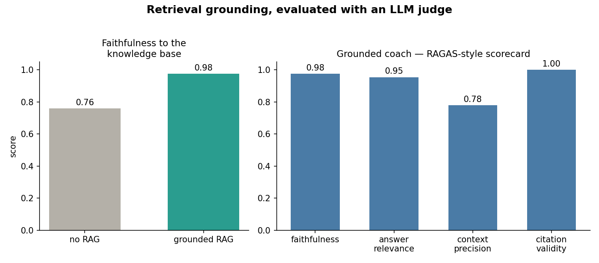

# Marathon strategy RAG

A retrieval-augmented marathon coach: ask a race-strategy question and get advice that cites the knowledge card behind every fact, several of them distilled from my own marathon data analyses.

[Live site](https://lyhjeremy.github.io/marathon-strategy-rag/) · [Write-up](https://lyhjeremy.github.io/marathon-strategy-rag/overview/) · [Long-form notes](writeup.md)

Design and copy follow [these standards](https://github.com/lyhjeremy/lyhjeremy/blob/main/DESIGN_STANDARDS.md).

## Results

Seven gold questions, scored by an LLM judge (`src/eval.py`, RAGAS-style). The bare baseline is the same model with retrieval switched off.

| Metric | Grounded coach | Bare model |
|---|---|---|
| Faithfulness to the knowledge base | 0.98 | 0.76 |
| Answer relevance | 0.95 | |
| Context precision | 0.78 | |
| Citation validity (computed in code) | 1.00 | |

The largest single gap is the heat question (0.40 bare, 0.97 grounded), where the answer depends on a figure from my Boston weather analysis. Per-question scores are in [`eval/results.csv`](eval/results.csv). `scripts/export_retrieval.py` records which passages the retriever ranks highest for each gold question (`eval/retrieval_demo.json`); the [write-up page](https://lyhjeremy.github.io/marathon-strategy-rag/overview/) shows them, and they explain the carbohydrate question's low context precision: three of its top five passages come from the carb-loading card, which is about the days before the race.

<p align="center">
  
</p>

## How it works

The knowledge base is 14 markdown cards in `knowledge/`, each with a `# Title` and a `> Source:` line. Eight cover established training principles (fueling, carb-loading, tapering, hydration, even pacing, long runs, race week, hills). The other six summarize my published analyses: [negative splits](https://lyhjeremy.github.io/marathon-negative-split-myth/) (2.5% of 31,912 Boston finishers), [the wall](https://lyhjeremy.github.io/marathon-pacing-decay/) (pace inflects near 30 km), [the heat tax](https://lyhjeremy.github.io/marathon-heat-tax/) (about 1 minute per °F), [Majors course difficulty](https://lyhjeremy.github.io/marathon-majors-course-difficulty/) (Boston +101 s against Berlin), [super-shoes](https://lyhjeremy.github.io/marathon-shoe-revolution-decomposition/) (about 67 s of the elite gain) and [BQ standards fairness](https://lyhjeremy.github.io/boston-marathon-qualifying-fairness/).

`src/ingest.py` splits each card into windows of about 120 words with a 30-word overlap, respecting paragraphs, and prefixes the card title. The chunks are embedded with `sentence-transformers/all-MiniLM-L6-v2` (384-dim), which runs locally on CPU, CUDA or Apple MPS, and stored in Chroma with cosine distance, keeping card, title and source as metadata. Retrieval is a dense top-k similarity search (k = 5 by default).

Claude then answers under a system prompt that allows only the retrieved passages and requires an `[n]` citation per fact. The default backend is the Claude CLI; setting `ANTHROPIC_API_KEY` switches to the Anthropic API. The chain exists twice: `src/coach.py` wires it by hand, and `src/chain_lc.py` builds the same flow as a LangChain LCEL pipeline, `{context: retrieve | format, query: passthrough} | prompt | llm` (`--engine lc`).

For evaluation, `src/eval.py` generates a grounded and a bare answer to each gold question, asks Claude as judge for faithfulness, answer relevance and context precision as strict JSON, and checks citation validity deterministically.

## Stack

Python, sentence-transformers, ChromaDB, LangChain (`langchain-core`), Claude CLI or Anthropic API, matplotlib.

## How to run

```bash
pip install -r requirements.txt

python -m src.ingest                 # index the bundled knowledge base

python -m src.cli ask "how should I pace the last 10K to avoid hitting the wall?"
python -m src.cli chat               # interactive coach

python -m src.cli ask "..." --engine lc   # same chain, built with LangChain LCEL
python -m src.eval                        # score faithfulness with an LLM judge
```

The knowledge base ships with the repo, so there is nothing to download. To add knowledge, write a new `knowledge/<topic>.md` card with a `# Title` and a `> Source:` line and rerun `python -m src.ingest`.

## Repo layout

| Path | What it is |
|---|---|
| `knowledge/*.md` | The knowledge base, one citable card per topic |
| `src/ingest.py` | Parse cards, chunk, embed locally, write the Chroma index |
| `src/embedder.py` | Local sentence-transformers embedder |
| `src/retriever.py` | Semantic search over the chunks |
| `src/coach.py` | Hand-rolled RAG chain: retrieve, then a grounded, cited answer |
| `src/chain_lc.py` | The same chain in LangChain LCEL (`--engine lc`) |
| `src/eval.py` | LLM-judge evaluation and the deterministic citation check |
| `src/llm.py` | LLM wrapper: Claude CLI (default) or Anthropic API |
| `src/cli.py` | `ask` (one question) and `chat` (interactive) |
| `eval/` | `results.csv` and `faithfulness.png` from the last evaluation run, plus `retrieval_demo.json` |
| `scripts/export_retrieval.py` | Writes the per-question retrieval rankings shown on the write-up page |

## Limitations

- Seven gold questions, all written to be answerable from the cards. The scores show a clear gap between grounded and bare answers on in-scope questions, but seven is too few for a precise measurement.
- The judge is an LLM from the same family as the generator. Bare faithfulness measures agreement with the retrieved passages, so a correct claim that the cards don't contain still counts against the bare model.
- Retrieval is dense-only with a single query and no reranker, which is where the 0.78 context precision comes from. The sibling [wine sommelier RAG](https://github.com/lyhjeremy/wine-sommelier-rag) uses BM25 plus a cross-encoder.
- Several cards come from single-race Boston analyses, and their caveats carry over.
- `knowledge/course-difficulty.md` states Boston +101 s and New York +78 s as facts about the real courses. The [course-difficulty study](https://lyhjeremy.github.io/marathon-majors-course-difficulty/) behind it ran on a simulated field with penalties set in code, so those figures describe a method test, not the courses. The card predates that correction and hasn't been rewritten, because changing it would leave the published evaluation describing a different corpus. The downhill gold question retrieves it, and faithfulness can't flag it because the answer agrees with the card.

## License

[MIT](LICENSE) © 2026 Jeremy Lee. Educational tool, not coaching or medical advice.
